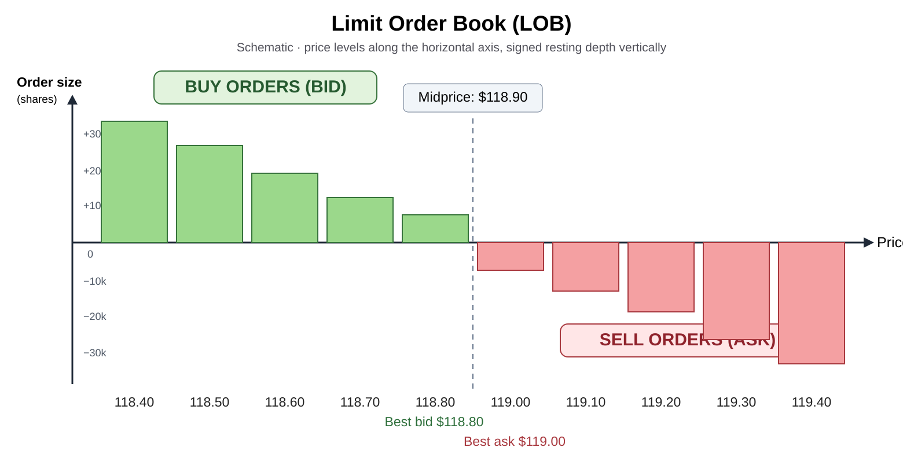
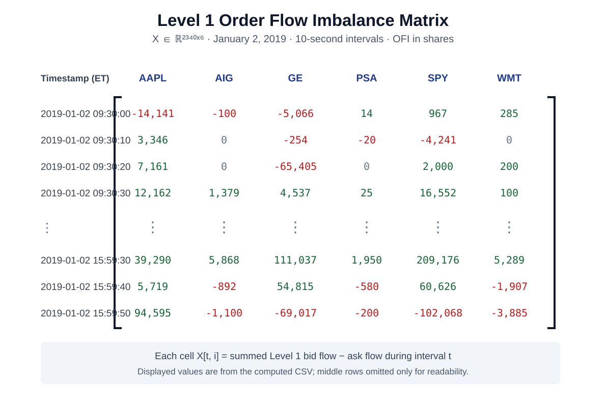

# Microstructure Order Flow

Baseline pipeline for the Math 199 project on decomposition of equity order flow for return forecasting.

## Current milestone

This first version follows the lecture-slide setup before moving to the broader proposal:

1. Read paired LOBSTER message and order-book files.
2. Reconstruct the top 10 book levels.
3. Compute event-level bid/ask order flow and 10-second multi-level OFI.
4. Normalize OFI by average book depth.
5. Apply PCA across the 10 levels to create integrated OFI for each stock.
6. Align stocks in time and estimate a one-factor model:

   OFI_i,t = mu_i + gamma_i F_t + tau_i,t

7. Save cross-asset correlation/covariance matrices.
8. Estimate a CC-style cross-impact model and save the self/cross-impact coefficient matrix.

This produces both plausible versions of the "matrix" discussed in the meeting: covariance/correlation matrices of order flow and the cross-impact coefficient matrix.

## Visualizations

### Limit order book

Slide-inspired layout with a horizontal price axis: buy-side depth rises above zero and sell-side depth falls below zero. The pipeline reconstructs top 10 levels from LOBSTER event files.

The fitted cross-impact coefficient matrix, when generated, is exported to `outputs/cross_impact_coefficient_matrix.csv`.

### Observed Level 1 OFI matrix (numerical representation)

This figure displays **actual computed OFI entries** from January 2, 2019 using AAPL, AIG, GE, PSA, SPY, and WMT. Each row is a 10-second interval, each column is one asset, and the entries are signed Level 1 OFI in shares. The complete observed matrix contains **2,340 rows × 6 assets**; only the first and last rows are shown above. A true `n × 80` matrix will require matching-date LOBSTER files for 80 assets. See [how to build and validate the matrix](docs/level1_ofi_matrix.md).

## Level 1 order-flow imbalance matrix (n × 80 target)

[Matrix construction, equation, inputs, limitations, and example](docs/level1_ofi_matrix.md).

Run `python scripts/build_level1_ofi_matrix.py <LOBSTER .7z archives>` to create a timestamp-by-asset Level 1 OFI CSV and a per-ticker coverage report. This is distinct from the cross-impact coefficient matrix. A true observed `n × 80` matrix needs matching-date LOBSTER data for 80 assets; the supplied 2019 sample currently covers six.

## Setup

Create a virtual environment, then install:

    pip install -r requirements.txt

## Run

Pass the LOBSTER archives directly:

    python scripts/run_pipeline.py /path/to/AAPL.7z /path/to/AIG.7z /path/to/GE.7z /path/to/PSA.7z /path/to/SPY.7z /path/to/WMT.7z

For the first cross-sectional experiment, use the six same-date 2019 archives (AAPL, AIG, GE, PSA, SPY, WMT). Analyze the 2016 PSA/TFX/FTV set separately because it does not overlap in time with the 2019 sample.

## Main outputs

The outputs directory will contain:

- per-ticker 10-second bucket features;
- PCA weights across the 10 LOB levels;
- integrated OFI panel;
- integrated OFI correlation and covariance matrices;
- common OFI factor;
- factor loadings and R-squared values;
- idiosyncratic OFI residuals;
- residual correlation and covariance matrices;
- cross-impact coefficient matrix.

## Interpretation

There are two distinct dimension-reduction steps.

Within each stock, the 10 OFI levels are strongly correlated, so PC1 compresses them into one integrated OFI signal.

Across stocks, integrated OFIs are aligned by timestamp. A second PC1 estimates a common market-wide order-flow factor. Regressing each stock's integrated OFI on that factor leaves the idiosyncratic component tau_i,t.

That residual is the bridge to the original proposal. The next model can replace the single statistical factor with explicit market, sector, size, momentum, and ETF factors and test whether residual order flow predicts residual returns.

## Next step

After validating this baseline on the uploaded sample, add diagnostic heatmaps and then compare:

- raw best-level OFI;
- integrated multi-level OFI;
- common-factor residual OFI;
- SPY/market-residualized OFI;
- forward returns in rolling out-of-sample windows.
