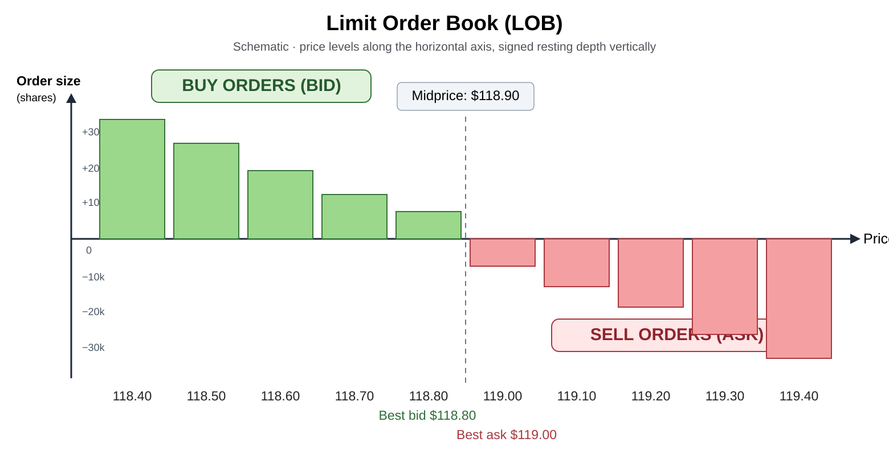
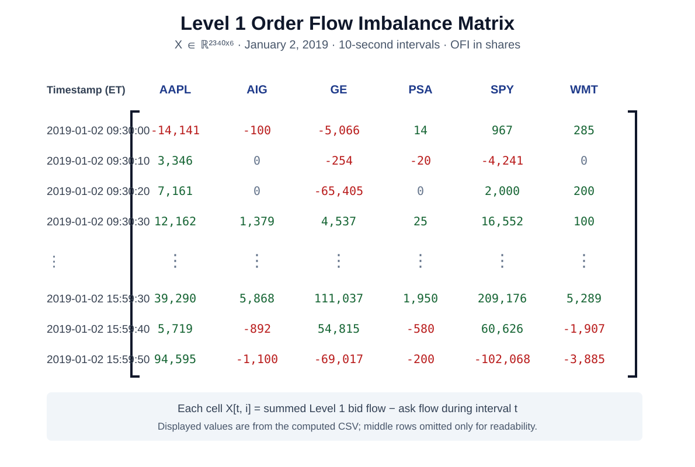

# Microstructure Order Flow

## July 2025: observed 80-stock, three-day OFI experiment

The newest research experiment reconstructs **provisional Level 1 order flow** across **80 equities** over **July 29–31, 2025**, using 78 nonoverlapping five-minute buckets per day (tensor shape `3 × 78 × 80`). It compares raw OFI, traded-volume-normalized OFI, and displayed Level 1 depth-normalized OFI, followed by training-only standardized SVD, exploratory Robust PCA, and held-out residual-persistence diagnostics.

- [Experiment report, QC, and preliminary findings](docs/research/2025-07-three-day-ofi.md)
- [Pipeline source](scripts/lobster2/ofi_team_pipeline.py) and [matching message-book reconstructor](scripts/lobster2/reconstruct_ofi.py)
- [Exact 80-ticker universe](universe_candidates.csv)
- [Aggregate depth-normalized factor metrics](docs/research/2025-07-depth-summary.json) and [volume-normalized factor metrics](docs/research/2025-07-volume-summary.json)

**Status:** computational pipeline completed and figures produced on lobster2; quotes have not been independently verified. The public repository intentionally **does not add the new July 2025 licensed market-data archives, derived matrices/tensors, or factor plots**. Those remain on authorized systems pending lab/license confirmation.

To reproduce **on an authorized host with access to `/lobster/2025`**:

```bash
python -m pip install -r requirements.txt
# The 7z executable is also required.
OPENBLAS_NUM_THREADS=1 python scripts/lobster2/ofi_team_pipeline.py build \
  --universe universe_candidates.csv --dates 20250729 20250730 20250731 --limit 80
OPENBLAS_NUM_THREADS=1 python scripts/lobster2/ofi_team_pipeline.py factors \
  --train-days 2 --metric ofi_per_depth --half-life-days 5 \
  --output team_results/factors_depth
OPENBLAS_NUM_THREADS=1 python scripts/lobster2/ofi_team_pipeline.py factors \
  --train-days 2 --metric ofi_per_volume --half-life-days 5 \
  --output team_results/factors_volume
```

### Follow-up checks without reprocessing 240 archives

The following commands use existing private outputs on lobster2 (not raw archives). Generated results remain under team_results/, which is Git-ignored.

~~~bash
git pull
python -m unittest discover -s tests -v
python scripts/lobster2/audit_research.py --input team_results --output team_results/audit
OPENBLAS_NUM_THREADS=1 python scripts/lobster2/refine_rpca.py --input team_results --metric ofi_per_depth --train-days 2
OPENBLAS_NUM_THREADS=1 python scripts/lobster2/refine_rpca.py --input team_results --metric ofi_per_volume --train-days 2
~~~

- The audit checks five-minute bucket alignment, completeness, normalization identities, book-reconstruction warnings, numerical decomposition identities and descriptive residual persistence. Outputs: team_results/audit/audit.md and audit.json.
- The RPCA sensitivity script varies train-only regularization and compares sparse fraction, low-rank complexity and held-out projection to equal-rank SVD. Outputs: team_results/rpca_tuning/.
- Neither tool substitutes for independently validated quote snapshots or actual future-return labels. No predictive effect has been demonstrated.


### Complete the extended empirical workflow on lobster2

The initial three-day run is saved under team_results/. Do not rebuild it. All extended outputs remain private and are ignored by Git.

~~~bash
# Run from an SSH session in ~/ofi-research; copy the latest scripts from GitHub
mkdir -p scripts/lobster2
for f in ofi_team_pipeline.py reconstruct_ofi.py extend_cached_panel.py extract_midquotes.py predict_residual_returns.py validate_reference_quotes.py audit_research.py refine_rpca.py; do
  curl -fsSL https://raw.githubusercontent.com/AlexNicholasWang/microstructure_order_floor/main/scripts/lobster2/$f -o scripts/lobster2/$f
done

# Analyze previous results immediately without reading the archives again
OPENBLAS_NUM_THREADS=1 python scripts/lobster2/audit_research.py --input team_results --output team_results/audit
OPENBLAS_NUM_THREADS=1 python scripts/lobster2/refine_rpca.py --input team_results --metric ofi_per_depth --train-days 2
OPENBLAS_NUM_THREADS=1 python scripts/lobster2/refine_rpca.py --input team_results --metric ofi_per_volume --train-days 2

# Select the latest 20 fully populated trading days through July 31
python scripts/lobster2/extend_cached_panel.py --base team_results --output team_results_long --max-days 20 --until 20250731 --dry-run

# Reuse the existing three days, cache each additional stock/day and resume after interruptions
OPENBLAS_NUM_THREADS=1 python scripts/lobster2/extend_cached_panel.py --base team_results --output team_results_long --max-days 20 --until 20250731

# Reconstruct provisional midpoint time series. This requires another (cached) pass through source archives.
OPENBLAS_NUM_THREADS=1 python scripts/lobster2/extract_midquotes.py --input team_results_long --output team_results_long/prices

# Train on days 1-15 and evaluate on the five later days (horizons 5, 15, 30 min)
for m in ofi_per_depth ofi_per_volume; do
  OPENBLAS_NUM_THREADS=1 python scripts/lobster2/predict_residual_returns.py --input team_results_long --prices team_results_long/prices --metric $m --train-days 15 --output team_results_long/forward_tests/$m
done

# Also generate factor and RPCA plots for the full panel
for m in ofi_per_depth ofi_per_volume; do
  OPENBLAS_NUM_THREADS=1 python scripts/lobster2/ofi_team_pipeline.py factors --input team_results_long --output team_results_long/factors_$m --metric $m --train-days 15 --half-life-days 5
done
~~~

**Quote-validation prerequisite:** To verify book reconstruction independently, obtain a reference CSV exported from actual order-book snapshots with columns `minute,ticker,bid,ask,bid_size,ask_size`; `minute` is the matching 5-minute bucket-start timestamp and the reference quote is observed at its bucket end. Then, on lobster2:

~~~bash
python scripts/lobster2/validate_reference_quotes.py --reconstructed team_results_long/prices/end_of_bucket_quotes.csv --reference /path/to/independent_level1_quotes.csv
~~~

No snapshot means this independent validation cannot be marked complete. Even when validation passes, the preliminary future-midquote experiment measures statistical forecast performance, not tradeable profit or causality.

The earlier six-stock 2019 study below remains intact and uses a distinct paired order-book / multi-level OFI pipeline.

---

Baseline pipeline for the Math 199 project on decomposition of equity order flow for return forecasting.

## Current milestone

This first version follows the lecture-slide setup before moving to the broader proposal:

1. Read paired LOBSTER message and order-book files.
2. Reconstruct the top 10 book levels.
3. Compute event-level bid/ask order flow and 10-second multi-level OFI.
4. Normalize OFI by average book depth.
5. Apply PCA across the 10 levels to create integrated OFI for each stock.
6. Align stocks in time and estimate a one-factor model:

   OFI_i,t = mu_i + gamma_i F_t + tau_i,t

7. Save cross-asset correlation/covariance matrices.
8. Estimate a CC-style cross-impact model and save the self/cross-impact coefficient matrix.

This produces both plausible versions of the "matrix" discussed in the meeting: covariance/correlation matrices of order flow and the cross-impact coefficient matrix.

## Visualizations

### Limit order book



Slide-inspired layout with a horizontal price axis: buy-side depth rises above zero and sell-side depth falls below zero. The pipeline reconstructs top 10 levels from LOBSTER event files.

The fitted cross-impact coefficient matrix, when generated, is exported to `outputs/cross_impact_coefficient_matrix.csv`.

### Observed Level 1 OFI matrix (numerical representation)



This figure displays **actual computed OFI entries** from January 2, 2019 using AAPL, AIG, GE, PSA, SPY, and WMT. Each row is a 10-second interval, each column is one asset, and the entries are signed Level 1 OFI in shares. The complete observed matrix contains **2,340 rows × 6 assets**; only the first and last rows are shown above. A separate **provisional** 80-stock three-day matrix was subsequently reconstructed from July 2025 message archives; see the 2025 report above. See [how to build and validate the matrix](docs/level1_ofi_matrix.md).

## Level 1 order-flow imbalance matrix (n × 80 target)

[Matrix construction, equation, inputs, limitations, and example](docs/level1_ofi_matrix.md).

Run `python scripts/build_level1_ofi_matrix.py <LOBSTER .7z archives>` to create a timestamp-by-asset Level 1 OFI CSV and a per-ticker coverage report. This is distinct from the cross-impact coefficient matrix. The 2019 sample here contains six names; the separate 2025 message-only experiment above covers 80.

## Setup

Create a virtual environment, then install:

    pip install -r requirements.txt

## Run

Pass the LOBSTER archives directly:

    python scripts/run_pipeline.py /path/to/AAPL.7z /path/to/AIG.7z /path/to/GE.7z /path/to/PSA.7z /path/to/SPY.7z /path/to/WMT.7z

For the first cross-sectional experiment, use the six same-date 2019 archives (AAPL, AIG, GE, PSA, SPY, WMT). Analyze the 2016 PSA/TFX/FTV set separately because it does not overlap in time with the 2019 sample.

## Main outputs

The outputs directory will contain:

- per-ticker 10-second bucket features;
- PCA weights across the 10 LOB levels;
- integrated OFI panel;
- integrated OFI correlation and covariance matrices;
- common OFI factor;
- factor loadings and R-squared values;
- idiosyncratic OFI residuals;
- residual correlation and covariance matrices;
- cross-impact coefficient matrix.

## Interpretation

There are two distinct dimension-reduction steps.

Within each stock, the 10 OFI levels are strongly correlated, so PC1 compresses them into one integrated OFI signal.

Across stocks, integrated OFIs are aligned by timestamp. A second PC1 estimates a common market-wide order-flow factor. Regressing each stock's integrated OFI on that factor leaves the idiosyncratic component tau_i,t.

That residual is the bridge to the original proposal. The next model can replace the single statistical factor with explicit market, sector, size, momentum, and ETF factors and test whether residual order flow predicts residual returns.

## Next step

After validating this baseline on the uploaded sample, add diagnostic heatmaps and then compare:

- raw best-level OFI;
- integrated multi-level OFI;
- common-factor residual OFI;
- SPY/market-residualized OFI;
- forward returns in rolling out-of-sample windows.
